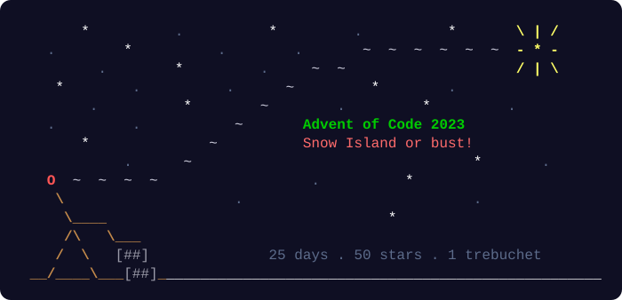

# 🎄 Advent of Code 2023

[](https://github.com/JeffESchmitz/AoC2023/actions/workflows/lint.yml)


<p align="center">
  
</p>

My [AoC 2023](https://adventofcode.com/2023) solutions in Swift. Global snow production has stopped, and the Elves' plan to fix it starts with launching you into the sky by trebuchet.

This repo was generated from gereon's [AoCTemplate](https://codeberg.org/gereon/AoCTemplate), with minor modifications to fit my working style (see [Changes from the template](#-changes-from-the-template)).

## ⭐ 2023 Progress

```
███░░░░░░░░░░░░░░░░░░░░░░  Stars (6/50)
```

| Day | Title | Stars | Key Technique |
|----:|-------|:-----:|---------------|
| [1](Sources/Day01.swift) | [Trebuchet?!](https://adventofcode.com/2023/day/1) | ⭐⭐ | Scan digits and overlapping spelled numbers |
| [2](Sources/Day02.swift) | [Cube Conundrum](https://adventofcode.com/2023/day/2) | ⭐⭐ | Parse draws and track per-color maxima |
| [3](Sources/Day03.swift) | [Gear Ratios](https://adventofcode.com/2023/day/3) | ⭐⭐ | Grid adjacency and gear-to-number mapping |
| [4](Sources/Day04.swift) | [Scratchcards](https://adventofcode.com/2023/day/4) | | |
| [5](Sources/Day05.swift) | [If You Give A Seed A Fertilizer](https://adventofcode.com/2023/day/5) | | |
| [6](Sources/Day06.swift) | [Wait For It](https://adventofcode.com/2023/day/6) | | |
| [7](Sources/Day07.swift) | [Camel Cards](https://adventofcode.com/2023/day/7) | | |
| [8](Sources/Day08.swift) | [Haunted Wasteland](https://adventofcode.com/2023/day/8) | | |
| [9](Sources/Day09.swift) | [Mirage Maintenance](https://adventofcode.com/2023/day/9) | | |
| [10](Sources/Day10.swift) | [Pipe Maze](https://adventofcode.com/2023/day/10) | | |
| [11](Sources/Day11.swift) | [Cosmic Expansion](https://adventofcode.com/2023/day/11) | | |
| [12](Sources/Day12.swift) | [Hot Springs](https://adventofcode.com/2023/day/12) | | |
| [13](Sources/Day13.swift) | [Point of Incidence](https://adventofcode.com/2023/day/13) | | |
| [14](Sources/Day14.swift) | [Parabolic Reflector Dish](https://adventofcode.com/2023/day/14) | | |
| [15](Sources/Day15.swift) | [Lens Library](https://adventofcode.com/2023/day/15) | | |
| [16](Sources/Day16.swift) | [The Floor Will Be Lava](https://adventofcode.com/2023/day/16) | | |
| [17](Sources/Day17.swift) | [Clumsy Crucible](https://adventofcode.com/2023/day/17) | | |
| [18](Sources/Day18.swift) | [Lavaduct Lagoon](https://adventofcode.com/2023/day/18) | | |
| [19](Sources/Day19.swift) | [Aplenty](https://adventofcode.com/2023/day/19) | | |
| [20](Sources/Day20.swift) | [Pulse Propagation](https://adventofcode.com/2023/day/20) | | |
| [21](Sources/Day21.swift) | [Step Counter](https://adventofcode.com/2023/day/21) | | |
| [22](Sources/Day22.swift) | [Sand Slabs](https://adventofcode.com/2023/day/22) | | |
| [23](Sources/Day23.swift) | [A Long Walk](https://adventofcode.com/2023/day/23) | | |
| [24](Sources/Day24.swift) | [Never Tell Me The Odds](https://adventofcode.com/2023/day/24) | | |
| [25](Sources/Day25.swift) | [Snowverload](https://adventofcode.com/2023/day/25) | | |

**Total: 6/50 stars** ⭐ 🎄

## 📚 Problem-solving toolkit

Bring lessons from earlier years into each new puzzle:

- [Problem-solving guide](docs/problem-solving.md): eight questions, algorithm choices, and Swift pitfalls.
- [Puzzle teacher](docs/puzzle-teacher.md): hints and guided discovery, with direct help when requested.
- [Reusable prompts](docs/prompts.md): understanding, debugging, implementation, and reflection.
- [AoCTools cheatsheet](docs/aoctools-cheatsheet.md): utilities checked against the resolved 2023 dependency.
- [Daily checklist](docs/daily-checklist.md): this repository's commands and test behavior.

Create day-specific notes under `docs/learnings/` as you solve problems. The guides link to the original 2025 material for longer examples. They do not require a multi-agent setup.

## 🧝 Daily workflow

| Command | What it does |
|---|---|
| `./input.sh X` | Downloads day X's puzzle input (needs your session cookie in `.aoc-session`) |
| `./run X` | Runs day X in release mode (`./run all` runs every day) |
| `./test X` | Runs day X's tests (`./test` runs them all) |
| `./lint` | Checks the code with SwiftLint (`./lint --fix` autocorrects) |

For each puzzle:

1. `./input.sh X` to fetch the input.
2. Paste the puzzle's example into `testInput` in `Tests/DayXTests.swift`.
3. Solve in `Sources/DayX.swift`: parse in `init(input:)`, answer in `part1()` and `part2()`.
4. Replace the `nil` expected answers in the tests as you confirm them.
5. `./run X` for the real answers, then `./lint` before committing.

## 🔔 How the tests work

Tests never pass by accident:

- **No data, no test.** The example tests are skipped until `testInput` is filled in, and the solution tests are skipped until `./input.sh` has downloaded that day's input.
- **No expected answer, no pass.** Expected answers start as `nil`. Until you fill one in, its test fails and reports the answer your code computed, e.g. `No expected answer yet. Computed: 142`.

## 🎁 Project layout

Everything compiles into a single macOS command-line binary that runs from Xcode or Terminal.

- `Sources/DayX.swift`: the solution for day X
- `Sources/Inputs/DayX+Input.swift`: the puzzle input, created by `input.sh` and not committed, for [legal reasons](https://www.reddit.com/r/adventofcode/wiki/faqs/copyright/inputs)
- `Tests/DayXTests.swift`: the tests for day X
- `Sources/AoC.swift`: the `main()` function, which runs one or all puzzles and prints the solutions and elapsed time

The code relies on gereon's [AoCTools](https://codeberg.org/gereon/AoCTools) package, a collection of utility functions for things frequently used in AoC, such as 2D and 3D points, [hexagonal grids](https://www.redblobgames.com/grids/hexagons/), an [A\* pathfinder](https://en.wikipedia.org/wiki/A*_search_algorithm) and more.

## 🛷 Running

**Xcode:** open the package with `xed .`. `Cmd-R` runs the current day's puzzle during December, or all days in other months (change `defaultDay` in `AoC.swift` to override). `Cmd-U` runs the tests.

**Terminal:** `swift run AdventOfCode X` runs day X (1–25 or `all`), and `swift test --filter AoCTests.Day02Tests` runs one day's tests. The `./run` and `./test` scripts wrap these.

## 🦌 Setup

- macOS 26 or later, with Xcode selected as the developer directory (`sudo xcode-select -s /Applications/Xcode.app/Contents/Developer`, adjusted to your Xcode). SwiftLint and the AoCTools build need Xcode's tools, not just the Command Line Tools.
- SwiftLint for `./lint`: `brew install swiftlint`.
- Your adventofcode.com session cookie in `.aoc-session` for `input.sh` ([how to find it](https://www.reddit.com/r/adventofcode/comments/a2vonl/how_to_download_inputs_with_a_script/)). The file is gitignored.

## 🎅 Changes from the template

- **SwiftLint runs as a command, not a build plugin.** `./lint` checks the code locally and a GitHub Action checks every push, so the project's own build doesn't depend on SwiftLint.
- **Honest tests.** Tests skip until their data exists, and expected answers start as `nil` instead of `0`, so placeholder code can't pass.
- **Safer input downloads.** `input.sh` validates the day, only defaults to today in December, and leaves existing input untouched when a download fails. It identifies itself with this repo's URL.
- **Dependencies.** AoCTools comes from Codeberg, pinned to 0.1.x, which needs macOS 26. `Package.resolved` isn't committed.
- **All 25 days** are generated, matching 2023's calendar.

## 📜 License

The template code is MIT licensed by Gereon Steffens; see [LICENSE.md](LICENSE.md).
